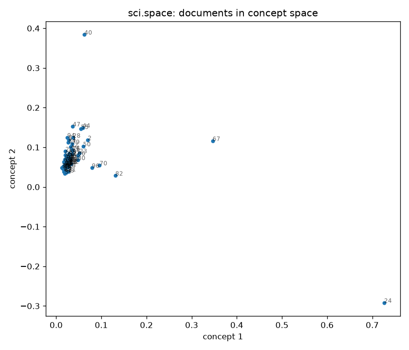
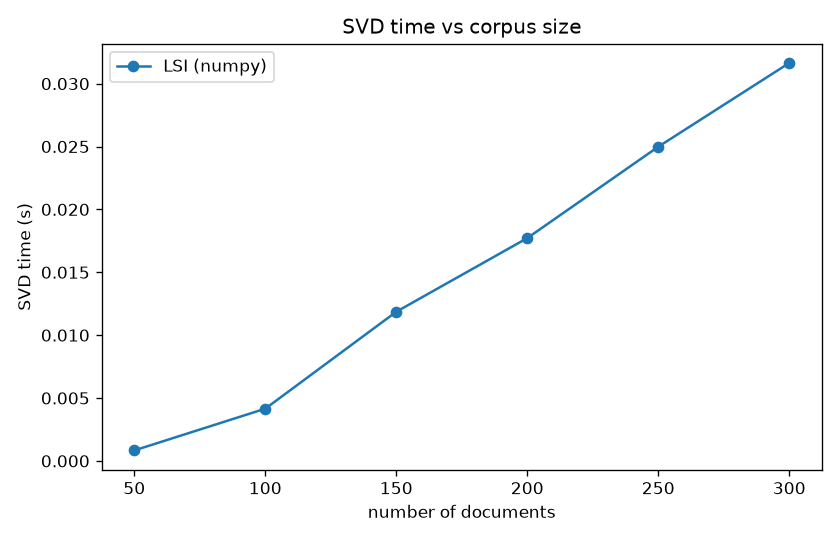

# LSI + Spark: Latent Semantic Indexing at scale

Master's final project (PFE). A small search engine based on **Latent Semantic Indexing (LSI)**,
built from scratch on the 20 Newsgroups dataset, plus a benchmark of the SVD step on a single
machine (numpy) vs. distributed with **Apache Spark** (MLlib `RowMatrix`, "MR-LSI").

## What it does

1. **Clean** the posts: lowercase, letters only, remove stop words, rare words (< 2 posts) and short posts (< 20 words).
2. **TF-IDF** term-document matrix, written by hand: `tf = count / doc_length`, `idf = log(N / df)`.
3. **SVD** `X ≈ U_k S_k V_kᵀ`. `k` is the smallest rank whose relative reconstruction error is below 0.38.
4. **Search**: fold the query into concept space (`q_k = qᵀ U_k S_k⁻¹`) and rank posts by cosine similarity.
5. **Benchmark**: time the SVD with numpy vs. Spark as the corpus grows.

## Install

```bash
python -m venv .venv
.venv\Scripts\activate          # Windows  (Linux/macOS: source .venv/bin/activate)
pip install -e ".[dev]"
pip install -e ".[spark]"       # optional, needs Java 17+
```

The dataset (~14 MB) downloads automatically on first run.

## Usage

```bash
python -m lsi search "moon landing orbit"   # top 5 posts for a query
python -m lsi concepts                      # top words of each concept
python -m lsi stats                         # corpus statistics
python -m lsi plot                          # posts on the first 2 concepts -> results/
python -m lsi benchmark                     # numpy SVD timings -> results/benchmark.png
python -m lsi benchmark --spark             # + Spark, local mode
python -m lsi benchmark --spark spark://HOST:7077   # + Spark standalone cluster
```

Every command takes `--category` (any 20 Newsgroups name, default `sci.space`) and `--docs`.
Cluster setup: [docs/spark-cluster.md](docs/spark-cluster.md).

Example:

```text
$ python -m lsi concepts -n 3
concept 1: gif, edu, sq, files, space, mb, com, sorry
concept 2: gif, edu, files, designs, server, jsc, adult, finished
concept 3: sq, mb, com, perijoves, language, unlikely, apr, mark
```

## Results





The chart above shows numpy only. Run `python -m lsi benchmark --spark` to add the Spark curve.

## Project layout

```text
lsi/
  preprocessing.py   load 20 Newsgroups, tokenize, filter
  tfidf.py           hand-written TF-IDF matrix
  model.py           LSI model: SVD, rank choice, search, concepts
  spark_svd.py       distributed SVD with Spark MLlib
  __main__.py        command line
tests/               pytest suite (Spark test skipped if pyspark is missing)
docs/                Spark standalone cluster guide
```

## Tests

```bash
pytest
```
